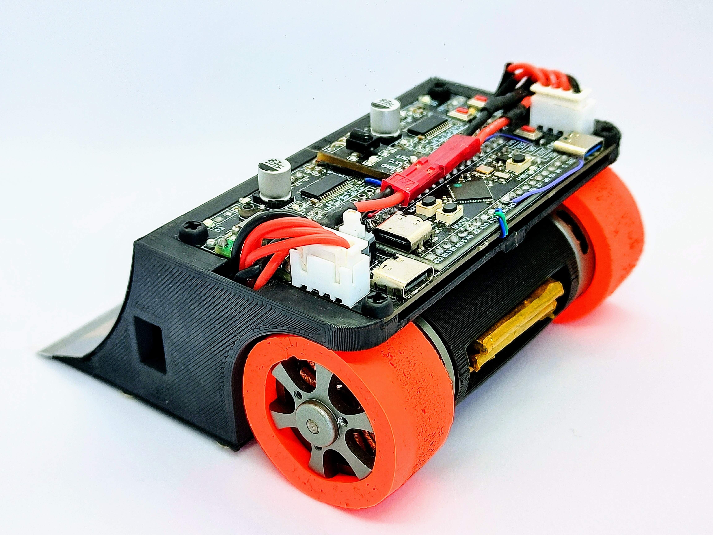
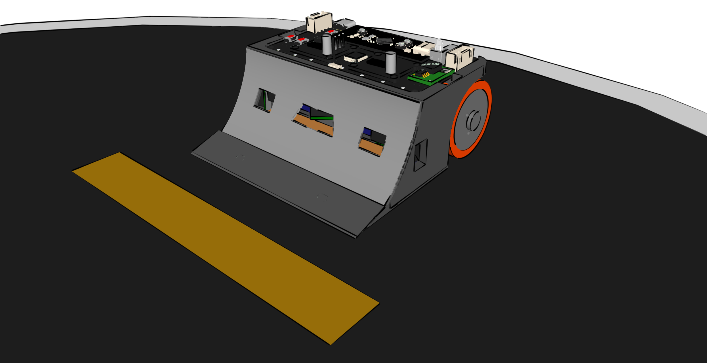
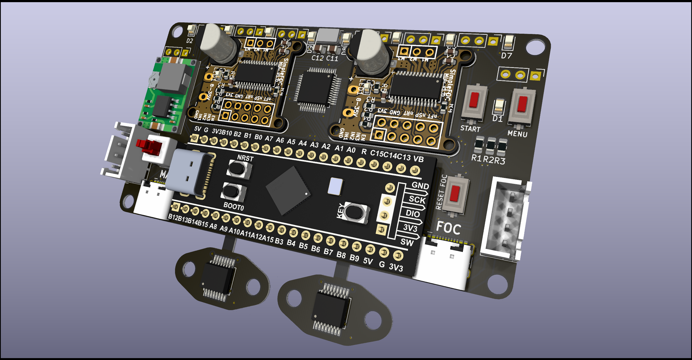
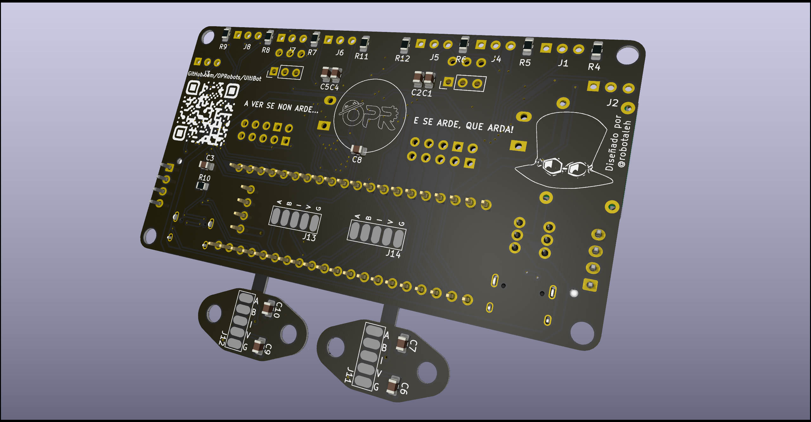
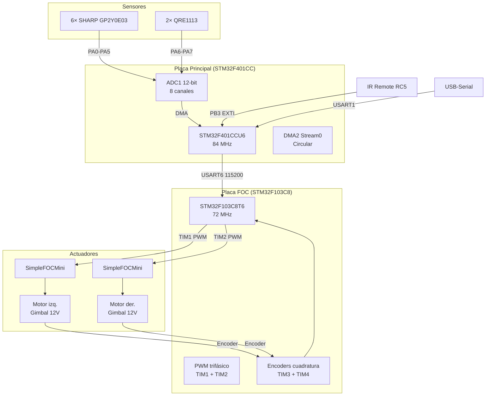

# Hardware

UltiBot usa una arquitectura de doble microcontrolador: un STM32F4 como cerebro
principal (estrategia, sensores, menú) y un STM32F1 como controlador de motores
(FOC). Ambos se comunican por USART a 115200 baudios.

## Microcontroladores

### Placa Principal — STM32F401CCU6 (BlackPill)

| Característica | Detalle |
|---------------|---------|
| **Modelo** | STM32F401CCU6 |
| **Arquitectura** | ARM Cortex-M4F (con FPU) |
| **Frecuencia** | 84 MHz (HSE 25 MHz → PLL) |
| **Flash** | 256 KiB (128 KiB utilizables en el linker) |
| **RAM** | 64 KiB |
| **Framework** | libopencm3 |
| **Debug** | ST-Link (SWD) |

### Placa FOC — STM32F103C8T6 (BluePill)

| Característica | Detalle |
|---------------|---------|
| **Modelo** | STM32F103C8T6 |
| **Arquitectura** | ARM Cortex-M3 |
| **Frecuencia** | 72 MHz (HSE 8 MHz → PLL) |
| **Flash** | 64 KiB |
| **RAM** | 20 KiB |
| **Framework** | libopencm3 |

> **Nota**: La placa FOC tiene su propia documentación en
> [OPRcontrolFOC](https://docs.oprobots.org/boards/OPRcontrolFOC).

---
## Sensores

### SHARP GP2Y0E03 — Distancia IR (6 unidades)

| Característica | Detalle |
|---------------|---------|
| **Modelo** | SHARP GP2Y0E03 |
| **Tipo** | Infrarrojo por triangulación |
| **Salida** | Analógica (0–3.3V) |
| **Interfaz** | ADC 12-bit (PA0–PA5) |
| **Filtro** | Media móvil 20 muestras |
| **Cantidad** | 6 (2 frontales, 2 angulados, 2 laterales) |

### QRE1113 — Sensores de línea (2 unidades)

| Característica | Detalle |
|---------------|---------|
| **Modelo** | QRE1113 |
| **Tipo** | Reflectivo IR |
| **Salida** | Analógica |
| **Interfaz** | ADC 12-bit (PA6–PA7) |
| **Cantidad** | 2 (izquierdo y derecho) |

### Disposición de sensores

| Sensor | ID | Canal ADC | GPIO | Función |
|--------|----|-----------|------|---------|
| Línea izquierda | `SENSOR_LINE_LEFT` (0) | CH7 | PA7 | Detección borde dohyo |
| Izquierda | `SENSOR_LEFT` (1) | CH6 | PA6 | Rival lateral izq. |
| Ángulo izquierda | `SENSOR_ANGLE_LEFT` (2) | CH3 | PA3 | Rival diagonal izq. |
| Frontal izquierda | `SENSOR_FRONT_LEFT` (3) | CH5 | PA5 | Rival frontal izq. |
| Frontal derecha | `SENSOR_FRONT_RIGHT` (4) | CH2 | PA2 | Rival frontal der. |
| Ángulo derecha | `SENSOR_ANGLE_RIGHT` (5) | CH4 | PA4 | Rival diagonal der. |
| Derecha | `SENSOR_RIGHT` (6) | CH1 | PA1 | Rival lateral der. |
| Línea derecha | `SENSOR_LINE_RIGHT` (7) | CH0 | PA0 | Detección borde dohyo |

---
## Actuadores

### Motores Brushless

| Característica | Detalle |
|---------------|---------|
| **Modelo** | Gimbal 12V 80T |
| **Tipo** | Brushless DC (BLDC) |
| **Driver** | SimpleFOCMini (MOSFET trifásico) |
| **Control** | FOC sinusoidal con PI de velocidad |
| **Frecuencia PWM** | ~28.125 kHz |
| **Resolución PWM** | 512 niveles |

Más detalles del control FOC en [Control](06-control-system.md) y en la
[documentación de OPRcontrolFOC](https://docs.oprobots.org/boards/OPRcontrolFOC).

---
## Alimentación

| Característica | Detalle |
|---------------|---------|
| **Batería** | 2× LiPo 3S (~11.1V nominal) |
| **Capacidad** | ~180 mAh cada una |
| **Regulador** | Mini360 (step-down) |
| **Monitorización** | No implementada en firmware |

> **⚠️ Advertencia**: El firmware no monitoriza el voltaje de batería. No hay
> protección por batería baja. Ver [BL-01](12-known-issues.md#bl-01).

---
## Chasis

| Característica | Detalle |
|---------------|---------|
| **Material** | PLA |
| **Fabricación** | Impresión 3D |
| **Ruedas** | JSUMO JS2622 |
| **Modelo 3D** | SketchUp + 14 archivos STL |

---
## PCB

| Característica | Detalle |
|---------------|---------|
| **Herramienta** | KiCad 7 |
| **Capas** | 2 (F.Cu + B.Cu) |
| **Grosor** | 0.57 mm total |
| **Acabado** | HASL lead-free |
| **Máscara** | Verde |
| **Serigrafía** | Blanca |

---
## Pinout — STM32F401CCU6

### GPIOs — LEDs y botones

| Pin | Periférico | Función |
|-----|-----------|---------|
| PA8 | GPIO OUT | LED de menú |
| PB1 | GPIO OUT | LED sensor frontal izq. |
| PB2 | GPIO OUT | LED sensor ángulo izq. |
| PB10 | GPIO OUT | LED sensor izquierda |
| PC13 | GPIO OUT | LED sensor derecha |
| PC14 | GPIO OUT | LED sensor ángulo der. |
| PC15 | GPIO OUT | LED sensor frontal der. |
| PB8 | GPIO IN (pull-up) | Botón de inicio |
| PB9 | GPIO IN (pull-up) | Botón de menú |

### ADC1 — Sensores

| Pin | Canal | Sensor |
|-----|-------|--------|
| PA0 | CH0 | Línea derecha |
| PA1 | CH1 | Derecha |
| PA2 | CH2 | Frontal derecha |
| PA3 | CH3 | Ángulo izquierda |
| PA4 | CH4 | Ángulo derecha |
| PA5 | CH5 | Frontal izquierda |
| PA6 | CH6 | Izquierda |
| PA7 | CH7 | Línea izquierda |

### USART

| Pin | Periférico | Función |
|-----|-----------|---------|
| PA9 (AF7) | USART1 TX | Consola debug |
| PA10 (AF7) | USART1 RX | Consola debug |
| PA11 (AF8) | USART6 TX | Comunicación FOC |
| PA12 (AF8) | USART6 RX | Comunicación FOC |

### RC5 (IR Remote)

| Pin | Periférico | Función |
|-----|-----------|---------|
| PB3 | EXTI3 | Receptor IR RC5 |

---
## Diagrama de Bloques

---
*Documento generado el 2026-06-30. Ver también [Arquitectura Software](02-software-architecture.md), [Sensores](04-sensors.md), [Control](06-control-system.md).*
