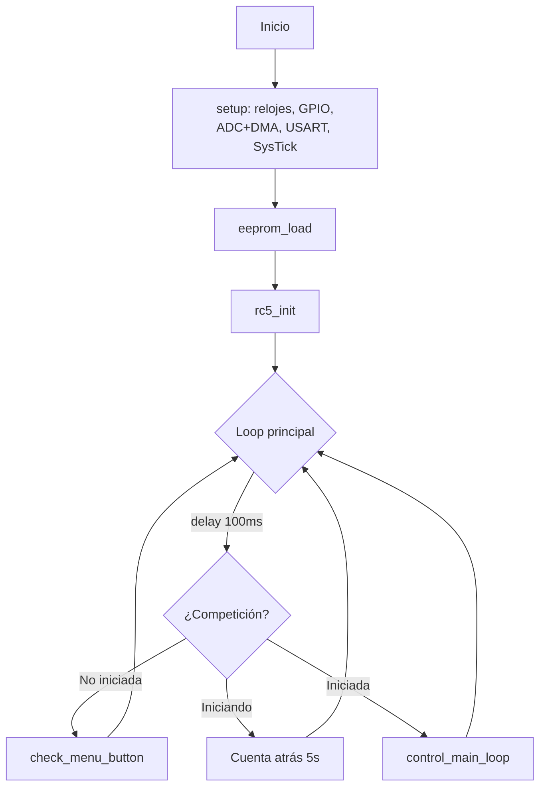
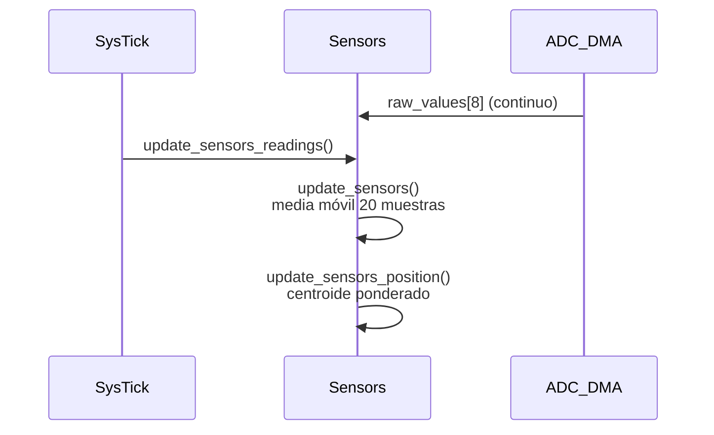
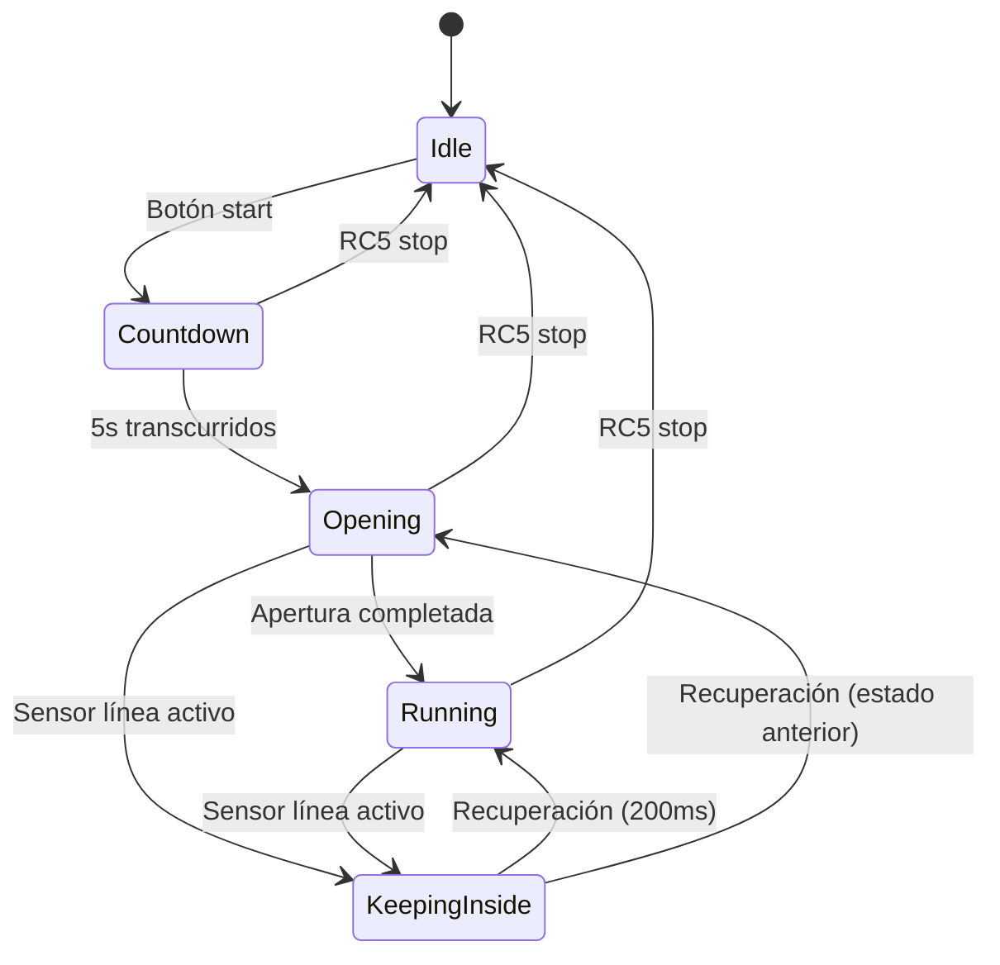

# Arquitectura Software

El firmware de UltiBot corre sobre dos microcontroladores independientes que se
comunican por USART. La placa principal (STM32F4) ejecuta el bucle de estrategia
a ~10 Hz mientras que la placa FOC (STM32F1) ejecuta el control de motores a
~1 kHz.

## Bucle Principal — STM32F401CCU6

### Tiempos del bucle principal

| Fase | Frecuencia | Descripción |
|------|-----------|-------------|
| Bucle principal | ~10 Hz | Estrategia, menú, LEDs |
| SysTick ISR | 1 kHz | Lectura de sensores, filtrado |
| DMA ADC | Continua | 8 canales en modo circular |

El bucle principal incluye un `delay(100)` incondicional que limita la tasa de
ejecución a ~10 Hz. La estrategia PID se ejecuta una vez por iteración del
bucle principal.

> **Nota**: El código contiene un TODO para mover `control_main_loop()` a una
> ISR independiente a 1 kHz, lo que mejoraría la frecuencia de control.
> Ver [SW-01](12-known-issues.md#sw-01).

---
## ISR del SysTick (1 kHz)

| Parámetro | Valor |
|-----------|-------|
| **Frecuencia** | 1 kHz |
| **Período** | 1 ms |

El `sys_tick_handler` ejecuta en cada tick:

1. `clock_tick()` — incrementa contador global de milisegundos
2. `update_sensors_readings()` — procesa el array de sensores completo
   - `update_sensors()`: media móvil de 20 muestras, calibración, umbralización
   - `update_sensors_position()`: cálculo del centroide ponderado del rival

---
## ISR del DMA2 Stream0

Se dispara al completar cada ciclo de 8 conversiones ADC. Solo limpia el flag
de interrupción — los datos ya están en el buffer circular `sensors_raw[]`
por DMA.

---
## ISR de USART6

Recibe respuestas de la placa FOC. Usa un buffer estático de 8 bytes.
Las tramas se delimitan por `\n`.

---
## ISR de EXTI3 (RC5)

Gestiona la recepción del mando infrarrojo RC5. Alterna entre flancos de subida
y bajada en cada interrupción para decodificar el protocolo Manchester.

---
## Máquina de Estados de Competición

### Estados

| Estado | Descripción |
|--------|-------------|
| **Idle** | Esperando botón de inicio. Menú y debug activos |
| **Countdown** | Cuenta atrás de 5 segundos con animación LED |
| **Opening** | Ejecutando maniobra de apertura seleccionada |
| **Running** | Estrategia de combate activa |
| **KeepingInside** | Recuperación tras detectar línea (retrocede 200ms + gira 200ms) |

---
## Distribución de prioridades NVIC

| Periférico | Prioridad (0=máx) | Función |
|-----------|-------------------|---------|
| SysTick | 16×1 = 16 | Temporización y sensores |
| TIM3 | 16×2 = 32 | (reservado) |
| DMA2 Stream0 | 16×3 = 48 | Transferencia ADC completa |
| USART6 | 16×4 = 64 | Recepción datos FOC |
| USART1 | 16×5 = 80 | Recepción debug |

---
## Compartición de código con OPRcontrolFOC

La placa principal incluye `commands.h` del submódulo OPRcontrolFOC mediante
el flag de compilación `-I ../OPRcontrolFOC/source_code/include`. Esto asegura
que ambos lados usen los mismos caracteres de comando (`D`, `E`, `R`, `L`).

---
*Documento generado el 2026-06-30. Ver también [Hardware](01-hardware.md), [Control](06-control-system.md), [Comunicaciones](03-communications.md).*
