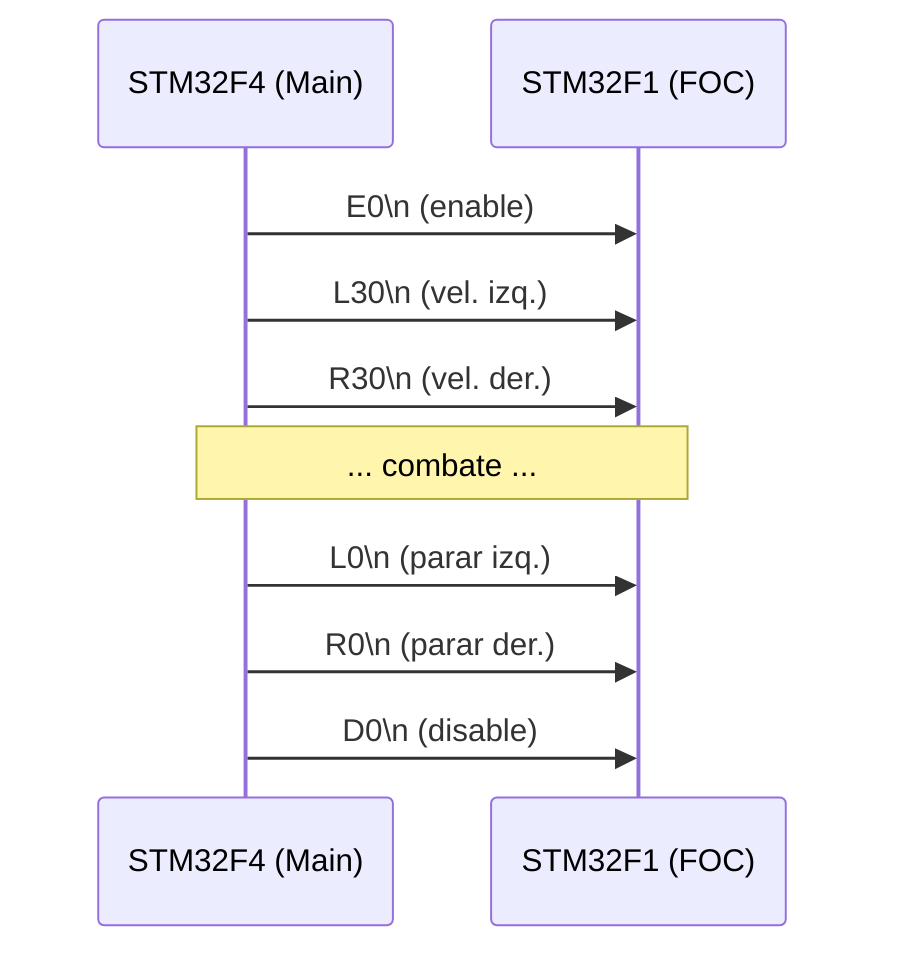
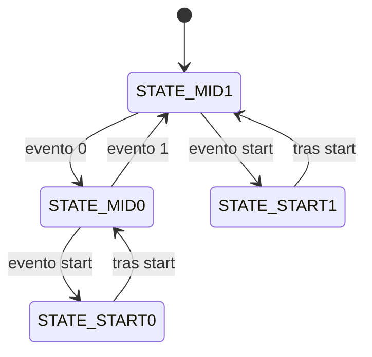

# Comunicaciones

UltiBot tiene dos sistemas de comunicación: un enlace USART entre los dos
microcontroladores (protocolo de comandos de motor) y un receptor infrarrojo
RC5 para control remoto (inicio/parada/menú).

## Enlace USART — Placa Principal ↔ Placa FOC

| Parámetro | Valor |
|-----------|-------|
| **Periférico** | USART6 (STM32F4) ↔ USART3 (STM32F1) |
| **Velocidad** | 115200 baudios |
| **Formato** | 8N1 (8 bits, sin paridad, 1 stop) |
| **Pines** | PA11 (TX), PA12 (RX) |
| **Protocolo** | Texto delimitado por `\n` |

### Protocolo de comandos

El protocolo es ASCII con un carácter de comando seguido de un valor entero,
terminado por salto de línea:

| Comando | Formato | Acción |
|---------|---------|--------|
| `D` | `D0\n` | Deshabilitar motores |
| `E` | `E0\n` | Habilitar motores |
| `L` | `L30\n` | Velocidad motor izquierdo (-80 a 80) |
| `R` | `R-50\n` | Velocidad motor derecho (-80 a 80) |

El comando se envía mediante `printf()`, que en UltiBot transmite a **ambos**
USART1 (debug) y USART6 (FOC) simultáneamente.

> **⚠️ Advertencia**: Cualquier `printf()` de debug se envía también a la placa
> FOC. La salida de debug puede interferir con el protocolo de comandos.
> Ver [CM-01](12-known-issues.md#cm-01).



### Implementación

El envío se realiza en [`motors.c:17`](../source_code/STM32F4CCU6/src/motors.c#L17):

```c
void set_motors_speed(int16_t velI, int16_t velD) {
  // clamp a [-80, 80]
  send_command(CMD_MOTOR_SPEED_LEFT, velI);
  send_command(CMD_MOTOR_SPEED_RIGHT, velD);
}
```

`send_command()` usa `printf("%c%d\n", command, value)` que transmite por ambos USARTs.

La recepción en la placa FOC se gestiona en la ISR de USART3, con un buffer de
8 bytes y parseo al recibir `\n`. Ver documentación de
[OPRcontrolFOC](https://docs.oprobots.org/boards/OPRcontrolFOC/03-communications/).

---
## Control Remoto RC5

| Parámetro | Valor |
|-----------|-------|
| **Protocolo** | RC5 (Philips) |
| **Frecuencia portadora** | 36 kHz |
| **Bits por trama** | 14 (2 start + 1 toggle + 5 address + 6 command) |
| **Receptor** | IR demodulador en PB3 (EXTI3) |
| **Decodificación** | Manchester por flancos |

### Direcciones y comandos

| Dirección | Valor | Función |
|-----------|-------|---------|
| `ADDRESS_PROG` | 0x0B | Programar códigos del mando |
| `ADDRESS_COMP` | 0x07 | Iniciar/parar competición |
| `ADDRESS_MENU` | 0x1B | Navegación de menú |

| Comando | Valor | Función |
|---------|-------|---------|
| `CUSTOM_CMD_MENU` | 0x0D | Cambio de modo de menú |
| `CUSTOM_CMD_MENU_UP` | 0x0E | Cambio de configuración (arriba) |
| `CUSTOM_CMD_MENU_DOWN` | 0x0C | Cambio de configuración (abajo) |

### Modo de programación

Al recibir una trama con `ADDRESS_PROG`, el firmware almacena los códigos del
mando en EEPROM. Los comandos se derivan secuencialmente:
- `DATA_STOP = command`
- `DATA_START = command + 1`
- `DATA_MENU = command`
- `DATA_MENU_UP = command + 1`
- `DATA_MENU_DOWN = command + 2`

### ISR de decodificación



La ISR alterna entre flancos de subida y bajada, midiendo la duración entre
ellos para clasificar pulsos cortos (444–1333 µs) y largos (1334–2222 µs).

---
## Salida de Debug — USART1

| Parámetro | Valor |
|-----------|-------|
| **Periférico** | USART1 |
| **Velocidad** | 115200 baudios |
| **Pines** | PA9 (TX), PA10 (RX) |
| **Función** | Consola serie (USB-Serial) |

Los modos de debug RAW, CALIBRATED y POSITION imprimen por USART1 a 20 Hz.

> **Nota**: La función `_write()` transmite tanto por USART1 como por USART6.
> Ver [CM-01](12-known-issues.md#cm-01) para el impacto de este diseño.

---
*Documento generado el 2026-06-30. Ver también [Arquitectura Software](02-software-architecture.md), [Debug](08-debug-system.md), [Menú](07-menu-system.md).*
