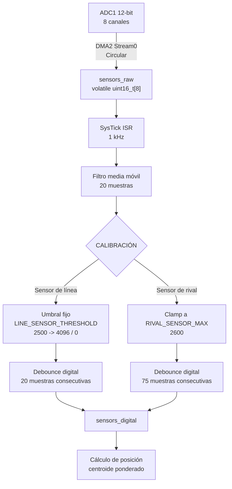

# Sensores

UltiBot utiliza 8 sensores infrarrojos muestreados por el ADC de 12 bits del
STM32F401 mediante DMA circular. El procesamiento se ejecuta en la ISR del
SysTick a 1 kHz.

## Hardware de Sensores

### Array de 8 sensores

| Sensor | Tipo | Modelo | Canal ADC | Pin |
|--------|------|--------|-----------|-----|
| Línea izquierda | Reflectivo IR | QRE1113 | CH7 | PA7 |
| Izquierda | Distancia IR | SHARP GP2Y0E03 | CH6 | PA6 |
| Ángulo izquierda | Distancia IR | SHARP GP2Y0E03 | CH3 | PA3 |
| Frontal izquierda | Distancia IR | SHARP GP2Y0E03 | CH5 | PA5 |
| Frontal derecha | Distancia IR | SHARP GP2Y0E03 | CH2 | PA2 |
| Ángulo derecha | Distancia IR | SHARP GP2Y0E03 | CH4 | PA4 |
| Derecha | Distancia IR | SHARP GP2Y0E03 | CH1 | PA1 |
| Línea derecha | Reflectivo IR | QRE1113 | CH0 | PA0 |

### Disposición física

Los 6 sensores SHARP cubren un arco de ~180° en el frontal del robot. Los
2 sensores QRE1113 están en la parte inferior para detectar el borde blanco
del dohyo.

## Cadena de Procesamiento



## Parámetros de Configuración

| Parámetro | Valor | Descripción |
|-----------|-------|-------------|
| `NUM_SENSORS` | 8 | Sensores totales |
| `NUM_SENSORS_LINE` | 2 | Sensores de línea |
| `SENSORS_FILTER_COUNT` | 20 | Muestras de la media móvil |
| `SENSOR_DIGITAL_COUNT` | 75 | Muestras para debounce rival |
| `SENSOR_LINE_DIGITAL_COUNT` | 20 | Muestras para debounce línea |
| `RIVAL_SENSOR_THRESHOLD` | 1400 | Umbral mínimo detección rival (~1.13V) |
| `RIVAL_SENSOR_CLOSE_THRESHOLD` | 2300 | Umbral rival cercano (~1.85V) |
| `RIVAL_SENSOR_MAX` | 2600 | Saturación máxima (~2.09V) |
| `LINE_SENSOR_THRESHOLD` | 2500 | Umbral detección línea (~2.01V) |

## Filtro de Media Móvil

Cada sensor mantiene un buffer circular de 20 lecturas raw. En cada tick del
SysTick se calcula el promedio:

$$sensors\_filtered[s] = \frac{1}{SENSORS\_FILTER\_COUNT} \sum_{i=0}^{19} filter\_buffer[s][i]$$

## Calibración

### Sensores de rival (SHARP)

Los valores filtrados se saturan a `RIVAL_SENSOR_MAX` (2600) si lo superan,
y se ponen a 0 si están por debajo de `RIVAL_SENSOR_THRESHOLD` (1400):

```
if (filtered >= RIVAL_SENSOR_THRESHOLD)
    calibrated = min(filtered, RIVAL_SENSOR_MAX)
else
    calibrated = 0
```

### Sensores de línea (QRE1113)

La calibración es binaria: se compara con `LINE_SENSOR_THRESHOLD` (2500).
Si se supera, el valor calibrado es `LECTURA_MAXIMO_SENSORES_LINEA` (4096);
si no, `LECTURA_MINIMO_SENSORES_LINEA` (0).

> **Nota**: `get_sensor_raw()` invierte la lógica para los sensores de línea,
> restando de 4096. Esto significa que un valor alto de ADC (superficie
> reflectante = línea blanca) produce una lectura cercana a 0 después de la
> inversión.

## Detección Digital con Debounce

Para considerar un sensor como "activo", se requiere que el valor calibrado
supere el umbral durante N muestras consecutivas:

| Sensor | Muestras requeridas |
|--------|-------------------|
| Rival (SHARP) | 75 (~75 ms) |
| Línea (QRE1113) | 20 (~20 ms) |

Si el valor cae por debajo del umbral, el conteo se reinicia a 0 y el sensor
se considera inactivo inmediatamente.

## Estimación de Posición del Rival

La posición se calcula como el centroide ponderado de los sensores activos
(sensores 1 a 6, excluyendo los de línea):

$$position = \frac{\sum w_i \cdot RIVAL\_SENSOR\_MAX}{\sum RIVAL\_SENSOR\_MAX} - 350$$

Donde $w_i$ es el índice del sensor (1 a 6) multiplicado por 100. La constante
350 centra la posición en 0.

> **Nota**: Actualmente la ponderación usa `RIVAL_SENSOR_MAX` (constante) en
> lugar del valor calibrado real del sensor. Esto produce una estimación basada
> solo en qué sensores están activos (binario), no en la intensidad de la señal.
> Ver [SS-01](12-known-issues.md#ss-01).

### Rango de posición

| Posición | Significado |
|----------|-------------|
| -250 | Rival detectado solo en sensor izquierdo |
| 0 | Rival centrado (o no detectado) |
| +250 | Rival detectado solo en sensor derecho |

## Detección de Rival

### Rival cercano

Se activa cuando cualquier sensor frontal o angular supera `RIVAL_SENSOR_CLOSE_THRESHOLD` (2300).
No tiene debounce.

### Rival detectado

La función `is_rival_detected()` aplica un debounce de 150 ms en la activación:
el rival debe estar presente de forma continua durante al menos 150 ms. La
desactivación es inmediata cuando los sensores dejan de ver al rival.

> **Nota**: El debounce es asimétrico — 150 ms para activar, 0 ms para
> desactivar. Ver [SS-02](12-known-issues.md#ss-02).

---
*Documento generado el 2026-06-30. Ver también [Hardware](01-hardware.md), [Movimiento](05-movement.md), [Control](06-control-system.md).*
