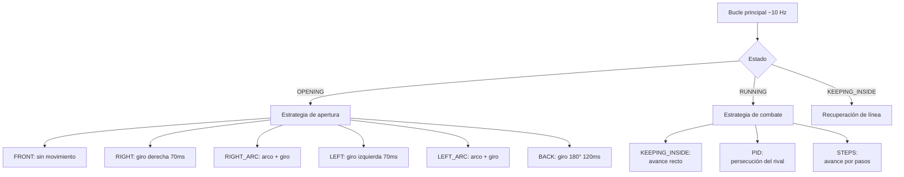
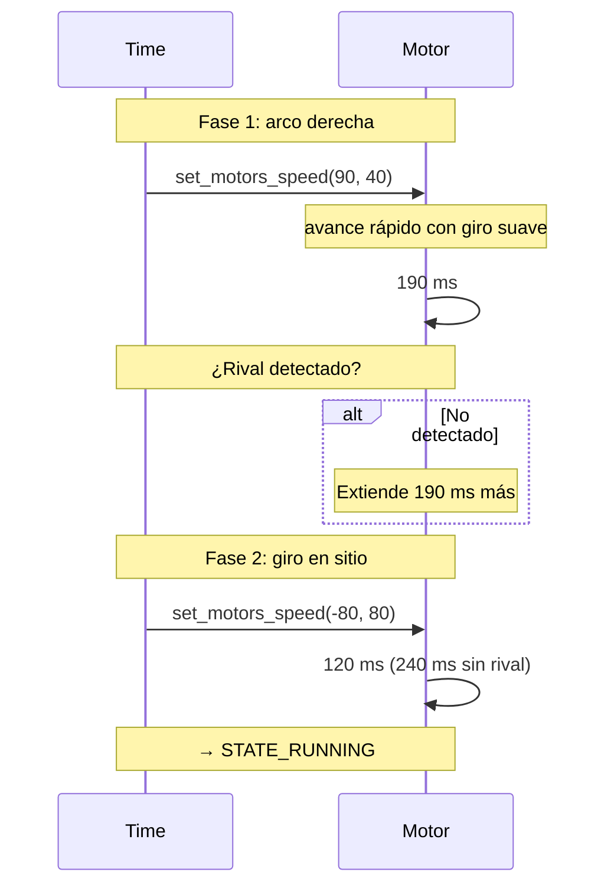
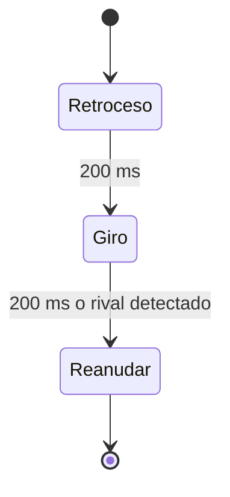

# Movimiento

El sistema de movimiento de UltiBot combina aperturas preprogramadas para el
inicio del combate con estrategias de persecución durante el mismo. Los comandos
de velocidad se envían a la placa FOC por USART.

## Arquitectura de Movimiento



## Comandos de Motor

La función [`set_motors_speed()`](../source_code/STM32F4CCU6/src/motors.c#L3)
envía comandos a la placa FOC:

```c
void set_motors_speed(int16_t velI, int16_t velD) {
  // clamp a [-80, 80]
  send_command(CMD_MOTOR_SPEED_LEFT, velI);
  send_command(CMD_MOTOR_SPEED_RIGHT, velD);
}
```

| Parámetro | Valor |
|-----------|-------|
| **Rango** | -80 a 80 |
| **Positivo** | Avance |
| **Negativo** | Retroceso |
| **Diferencia de signo** | Giro sobre el eje |

Los valores se saturan a ±80. La placa FOC interpreta el valor como porcentaje
de la velocidad máxima configurada (900 RPM nominales).

> **⚠️ Advertencia**: Algunas aperturas solicitan velocidad 90, que se satura
> silenciosamente a 80. Ver [MV-01](12-known-issues.md#mv-01).

## Aperturas (Openings)

Se ejecutan al inicio del combate, tras la cuenta atrás. Configurables desde
el menú.

| Apertura | Secuencia | Duración total |
|----------|-----------|----------------|
| **FRONT** | Sin movimiento, pasa directo a RUNNING | 0 ms |
| **RIGHT** | Giro derecha (80, -80) | 70 ms (140 ms sin rival) |
| **RIGHT_ARC** | Arco derecha (90→80, 40) + giro (-80, 80) | 310 ms (620 ms sin rival) |
| **LEFT** | Giro izquierda (-80, 80) | 70 ms (140 ms sin rival) |
| **LEFT_ARC** | Arco izquierda (40, 90→80) + giro (80, -80) | 310 ms (620 ms sin rival) |
| **BACK** | Giro 180° (80, -80) | 120 ms (240 ms sin rival) |

Cada apertura tiene un tiempo base y un tiempo extendido si no se detecta al
rival. Si el rival se detecta en cualquier momento, la apertura termina
anticipadamente y pasa al estado `STATE_RUNNING`.

### Ejemplo: RIGHT_ARC



## Estrategias de Combate

### STRAT_KEEPING_INSIDE

Avanza en línea recta a `BASE_SPEED` (30) en ambos motores. La protección
contra salida del dohyo la gestiona `check_outter_line()` que transiciona
al estado `STATE_KEEPING_INSIDE` si se detecta la línea blanca.

### STRAT_PID

Estrategia de persecución con control PD:

$$correccion = error \cdot K_p + \Delta error \cdot K_d$$

| Parámetro | Valor |
|-----------|-------|
| $K_p$ | 0.25 |
| $K_d$ | 25 |
| Velocidad base | 30 |
| Frecuencia | ~10 Hz |
| Rango de corrección | ±50 (limitado por clamp a ±80) |

Las velocidades se calculan como:
- Motor izquierdo: $BASE\_SPEED + corrección$
- Motor derecho: $BASE\_SPEED - corrección$

### STRAT_STEPS

Avanza en ráfagas de 50 ms cada 5 segundos, seguidas de 10 ms de pausa.
Tras 5 ráfagas (~25 s), cambia automáticamente a `STRAT_PID`.

Si se detecta al rival cercano, cambia inmediatamente a `STRAT_PID`.

## Recuperación de Línea (Keeping Inside)

Cuando cualquier sensor de línea detecta el borde del dohyo:

1. **Retroceso**: 200 ms a `-TURN_SPEED` (-60) en ambos motores
2. **Giro**: 200 ms a `(TURN_SPEED, -TURN_SPEED)` si no hay rival detectado
3. **Reanudación**: vuelve al estado anterior (`last_state`)



---
*Documento generado el 2026-06-30. Ver también [Control](06-control-system.md), [Sensores](04-sensors.md), [Comunicaciones](03-communications.md).*
