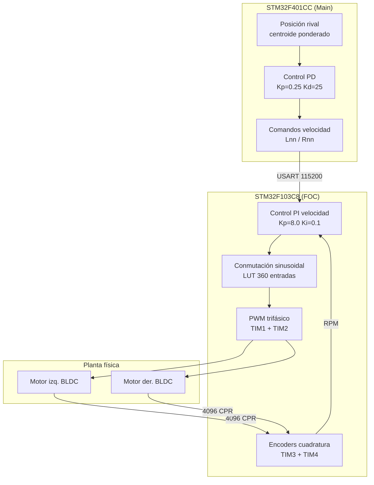

# Control

UltiBot implementa dos niveles de control:

1. **Control de alto nivel** en la placa principal (STM32F4): estrategia PD
   de persecución basada en la posición estimada del rival
2. **Control de bajo nivel** en la placa FOC (STM32F1): lazo PI de velocidad
   con conmutación sinusoidal (FOC)

## Arquitectura de Control



---
## Control PD de Persecución — Placa Principal

### Ecuación de control

$$
\begin{aligned}
correccion &= error \cdot K_p + \Delta error \cdot K_d \\
v_L &= BASE\_SPEED + correccion \\
v_R &= BASE\_SPEED - correccion
\end{aligned}
$$

Donde:
- $error$ = posición estimada del rival (rango $\sim[-250, 250]$)
- $\Delta error = error - error_{anterior}$

### Parámetros

| Parámetro | Valor | Descripción |
|-----------|-------|-------------|
| $K_p$ | 0.25 | Ganancia proporcional |
| $K_d$ | 25 | Ganancia derivativa |
| `BASE_SPEED` | 30 | Velocidad base (sobre 80) |
| `TURN_SPEED` | 60 | Velocidad de giro (sobre 80) |
| Frecuencia | ~10 Hz | Tasa de ejecución |

> **Nota**: La ganancia derivativa (25) es 100× mayor que la proporcional
> (0.25). Esto produce una respuesta muy sensible a cambios rápidos en la
> posición del rival, priorizando la persecución sobre el centrado.

### Código de control

[`control.c:131-157`](../source_code/STM32F4CCU6/src/control.c#L131-L157):
```c
int16_t error = get_sensors_position();
float correccion = error * STRAT_PID_KP
    + (error - strat_pid_last_error) * STRAT_PID_KD;
set_motors_speed(BASE_SPEED + correccion, BASE_SPEED - correccion);
```

### Límites de velocidad

| Dirección | Velocidad min | Velocidad max |
|-----------|:-----------:|:-----------:|
| Motor izquierdo | BASE_SPEED - 50 ≈ -20 | BASE_SPEED + 50 ≈ 80 |
| Motor derecho | BASE_SPEED - 50 ≈ -20 | BASE_SPEED + 50 ≈ 80 |

La corrección máxima efectiva es ±50 (limitada por el clamp a ±80 en
`set_motors_speed()`).

---
## Control PI de Velocidad + FOC — Placa FOC

> **Nota**: Esta sección es un resumen. La documentación completa está en
> [OPRcontrolFOC](https://docs.oprobots.org/boards/OPRcontrolFOC).

### Lazo PI de velocidad

| Parámetro | Valor |
|-----------|-------|
| $K_p$ | 8.0 |
| $K_i$ | 0.1 |
| $K_d$ | 0.0 (deshabilitado) |
| Rango velocidad | -900 a +900 RPM |
| Frecuencia control | ~1 kHz |

### Anti-windup

El integrador se detiene cuando `speed_factor >= 100` y el error es positivo
(motor ya está al máximo y se le pide más).

### Conmutación sinusoidal (FOC)

- Tabla de seno de 360 entradas precalculada
- 3 fases con 120° de separación por motor
- La posición del rotor (encoder) determina el ángulo eléctrico
- El `speed_factor` (0-100%) modula la amplitud

### Secuencia de fases

| Motor | Fase A | Fase B | Fase C |
|-------|--------|--------|--------|
| Izquierdo | TIM2 CH2 (PA1) | TIM2 CH1 (PA0) | TIM2 CH3 (PA2) |
| Derecho | TIM1 CH1 (PA8) | TIM1 CH3 (PA10) | TIM1 CH2 (PA9) |

Las fases no siguen el orden estándar A→B→C en ambos motores. El motor
izquierdo usa orden C→B→A y el derecho A→C→B.

---
## Saturación

Ambos niveles de control incluyen mecanismos de saturación:

| Nivel | Mecanismo | Indicador |
|-------|-----------|-----------|
| Velocidad comando | Clamp a ±80 | — |
| PI velocidad | Anti-windup integral | PC13 (der.), PC14 (izq.) |
| PWM | Clamp a ±PWM_PERIOD/2 | — |

---
*Documento generado el 2026-06-30. Ver también [Movimiento](05-movement.md), [Sensores](04-sensors.md), [Encoders](10-encoders-gyro.md).*
