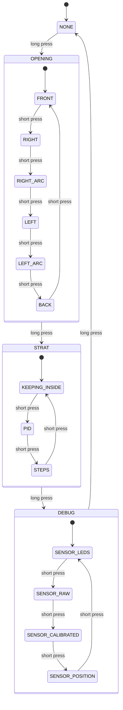

# Sistema de Menú

UltiBot dispone de un sistema de menú controlado por botón físico y mando
infrarrojo RC5. Permite configurar la apertura inicial, la estrategia de
combate y el modo de debug sin necesidad de reprogramar.

## Navegación

| Acción | Botón físico | Mando RC5 |
|--------|-------------|-----------|
| Cambiar modo | Pulsación larga (≥250 ms) | `CUSTOM_CMD_MENU` |
| Cambiar opción | Pulsación corta (<250 ms) | `CUSTOM_CMD_MENU_UP` / `CUSTOM_CMD_MENU_DOWN` |

## Modos de Menú



### MENU_NONE

Modo por defecto. Sin indicación LED. El robot espera el botón de inicio.

### MENU_OPENING

Configura la apertura inicial. LED de menú parpadea a 350 ms. Los LEDs de
sensores muestran la apertura seleccionada.

| Apertura | LEDs encendidos |
|----------|-----------------|
| FRONT | Frontal izq. + Frontal der. |
| RIGHT | Ángulo der. + Frontal der. |
| RIGHT_ARC | Frontal der. + Ángulo der. (combinación) |
| LEFT | Ángulo izq. + Izquierda |
| LEFT_ARC | Frontal izq. + Izquierda |
| BACK | Izquierda + Derecha |

### MENU_STRAT

Configura la estrategia de combate. LED de menú parpadea a 150 ms. Los LEDs
muestran animaciones específicas:

| Estrategia | Animación LED |
|------------|---------------|
| KEEPING_INSIDE | Laterales parpadean juntos (150 ms) |
| PID | Barrido secuencial ida y vuelta (50 ms) |
| STEPS | Barrido secuencial unidireccional (100 ms) |

### MENU_DEBUG

Accede a los modos de debug. LED de menú fijo. Ver [Debug](08-debug-system.md).

---
## Botones Físicos

| Botón | Pin | Función |
|-------|-----|---------|
| Start | PB8 (pull-up) | Iniciar competición |
| Menú | PB9 (pull-up) | Navegación de menú |

Ambos botones usan debounce de 50 ms mediante doble lectura separada por
[`delay(50)`](../source_code/STM32F4CCU6/src/buttons.c#L11).

### Pulsación larga vs corta

El botón de menú distingue entre:
- **Pulsación corta** (<250 ms): cambia la opción dentro del modo actual
- **Pulsación larga** (≥250 ms): cambia al siguiente modo de menú

## Control Remoto RC5

El mando IR permite controlar el robot a distancia:

| Función | Dirección | Comando |
|---------|-----------|---------|
| Iniciar competición | `ADDRESS_COMP` | `DATA_START` |
| Parar competición | `ADDRESS_COMP` | `DATA_STOP` |
| Cambiar modo menú | `ADDRESS_MENU` | `CUSTOM_CMD_MENU` |
| Cambiar opción (arriba) | `ADDRESS_MENU` | `CUSTOM_CMD_MENU_UP` |
| Cambiar opción (abajo) | `ADDRESS_MENU` | `CUSTOM_CMD_MENU_DOWN` |

---
## Detalles de Implementación

[`menu.c:61-77`](../source_code/STM32F4CCU6/src/menu.c#L61-L77):
```c
void check_menu_button(void) {
  if (get_menu_mode_btn()) {
    menu_btn_ms = get_clock_ticks();
    while (get_menu_mode_btn()) {
      if (get_clock_ticks() - menu_btn_ms >= 250) {
        menu_long_press();        // cambia de modo
        while (get_menu_mode_btn()) {
          menu_loop();            // muestra feedback mientras se mantiene
        }
      }
      menu_loop();
    }
    if (get_clock_ticks() - menu_btn_ms < 250) {
      menu_short_press();         // cambia de opción
    }
  }
  menu_loop();                    // siempre muestra estado actual
}
```

> **Nota**: El menú solo está activo en estado IDLE (competición no iniciada).
> Durante la competición, `check_menu_button()` no se llama.

---
*Documento generado el 2026-06-30. Ver también [Debug](08-debug-system.md), [Comunicaciones](03-communications.md), [Batería y LEDs](11-power-leds.md).*
