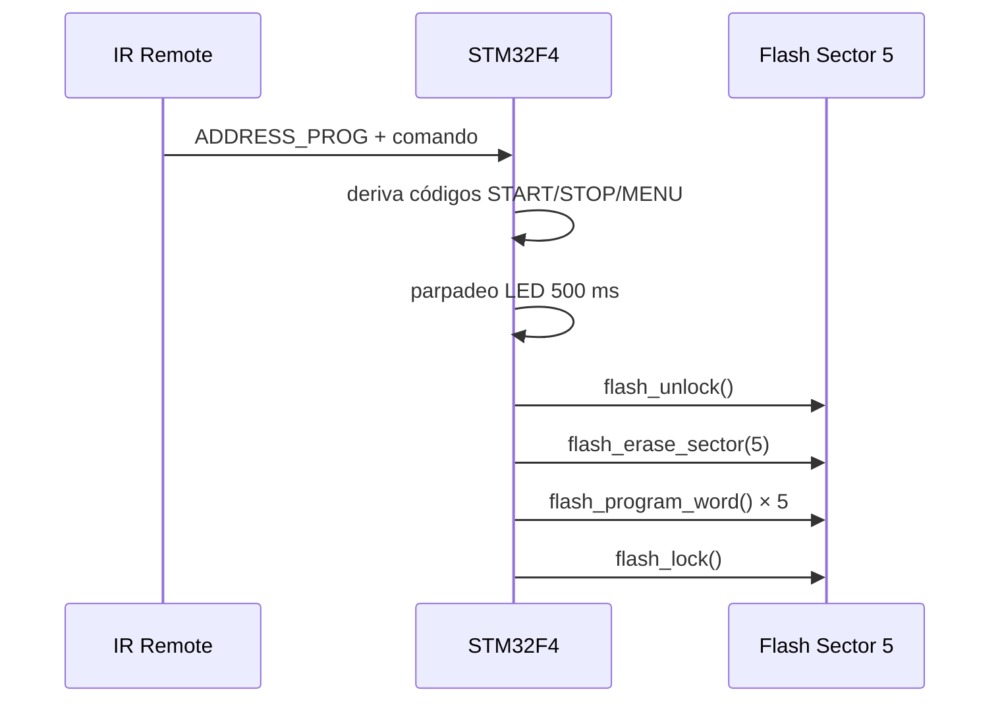

# Almacenamiento

UltiBot utiliza una EEPROM emulada en flash para almacenar los códigos del
mando RC5 de forma persistente entre reinicios. La implementación usa el
sector 5 de la flash del STM32F401CCU6.

## Configuración de Flash

| Parámetro | Valor |
|-----------|-------|
| **Sector** | 5 |
| **Dirección base** | `0x08020000` |
| **Tamaño sector** | 128 KiB (sectores 5–11 en STM32F401) |
| **Formato** | 16 bits por palabra (x16) |
| **Palabras almacenadas** | 5 (`DATA_LENGTH`) |

## Datos Almacenados

| Índice | Campo | Descripción |
|--------|-------|-------------|
| `DATA_STOP` (0) | Código STOP | Comando RC5 para parar competición |
| `DATA_START` (1) | Código START | Comando RC5 para iniciar competición |
| `DATA_MENU` (2) | Código MENU | Comando para cambiar modo de menú |
| `DATA_MENU_UP` (3) | Código UP | Comando para cambiar opción (arriba) |
| `DATA_MENU_DOWN` (4) | Código DOWN | Comando para cambiar opción (abajo) |

## Operaciones

### Carga (eeprom_load)

Se ejecuta al inicio, antes del bucle principal. Lee las 5 palabras desde
la dirección base mediante acceso directo a memoria:

```c
for (uint16_t i = 0; i < DATA_LENGTH; i++) {
  eeprom_data[i] = MMIO32(addr);
  addr += 4;
}
```

### Programación (eeprom_save)

Se ejecuta al recibir un comando de programación RC5 (`ADDRESS_PROG`):

1. **Indicación visual**: 500 ms de parpadeo rápido del LED de menú
2. **Borrado**: `flash_erase_sector(EEPROM_SECTOR, FLASH_CR_PROGRAM_X16)`
3. **Escritura**: 5 palabras secuenciales con `flash_program_word()`
4. **Bloqueo**: `flash_lock()`



> **⚠️ Advertencia**: La operación de guardado bloquea el sistema durante
> ~500 ms. Las interrupciones no se deshabilitan durante la escritura flash,
> lo que podría causar problemas si una ISR intenta acceder a la flash.
> Ver [EE-01](12-known-issues.md#ee-01).

### Limpieza (eeprom_clear)

Borra el sector sin reprogramar. Disponible pero no usado en el flujo normal.

### Actualización parcial (eeprom_set_data)

Permite modificar un subconjunto de palabras en RAM (no persiste hasta
`eeprom_save()`):

```c
void eeprom_set_data(uint16_t index, uint16_t *data, uint16_t length) {
  for (uint16_t i = index; i < index + length; i++) {
    eeprom_data[i] = data[i - index];
  }
}
```

---
## Derivación de Códigos RC5

Al recibir un comando de programación, los códigos se derivan del comando base:

```c
rc5_stored_data[DATA_STOP] = command;
rc5_stored_data[DATA_START] = command + DATA_START; // +1
rc5_stored_data[DATA_MENU] = command;
rc5_stored_data[DATA_MENU_UP] = command + 1;
rc5_stored_data[DATA_MENU_DOWN] = command + 2;
```

Esto asume que el mando RC5 envía códigos consecutivos para STOP, START, MENU,
UP y DOWN. La relación es fija en el firmware.

> **💡 Consejo**: Si se cambia de mando RC5, puede ser necesario reprogramar
> los códigos enviando `ADDRESS_PROG` con el comando base del nuevo mando.

---
## Integridad

No se implementa checksum ni verificación de integridad de los datos
almacenados. Si la flash se corrompe (p.ej., por un reset durante la
escritura), los códigos RC5 pueden quedar inválidos.

---
*Documento generado el 2026-06-30. Ver también [Comunicaciones](03-communications.md), [Menú](07-menu-system.md).*
