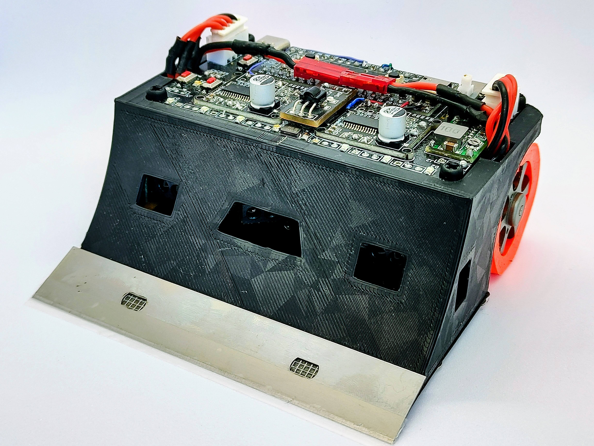

# UltiBot

Robot de minisumo con 6 sensores SHARP GP2Y0E03 y control FOC de motores
brushless. Diseñado para competiciones de la categoría Minisumo (500 g, 10×10 cm).

---
## ⚙️ Hardware

| Característica | Detalle |
|---------------|---------|
| **Microcontrolador principal** | STM32F401CCU6 (BlackPill) @ 84 MHz |
| **Microcontrolador FOC** | STM32F103C8T6 (BluePill) @ 72 MHz |
| **Sensores** | 6× SHARP GP2Y0E03 (IR distancia) + 2× QRE1113 (línea) |
| **Motores** | 2× Gimbal 12V 80T brushless |
| **Drivers** | 2× SimpleFOCMini (puentes MOSFET trifásicos) |
| **Batería** | 2× LiPo 3S ~180 mAh |
| **Ruedas** | JSUMO JS2622 |
| **Chasis** | PLA impreso en 3D |

---
## 💻 Software

| Componente | Detalle |
|-----------|---------|
| **Framework** | libopencm3 (bare-metal) |
| **Entorno** | PlatformIO + VS Code |
| **Lenguaje** | C11 |
| **Frecuencia control** | ~10 Hz (estrategia), 1 kHz (sensores), 10 kHz (FOC) |
| **Estrategias** | PID pursuit, Keeping Inside, Steps |
| **Aperturas** | 6 (frente, derecha, derecha arco, izquierda, izquierda arco, atrás) |
| **Debug** | 4 modos (LEDs, raw ADC, calibrado, posición) |

---
## 📚 Documentación

- [Hardware](01-hardware.md) — MCUs, sensores, motores, PCB, batería, chasis y pinout
- [Arquitectura Software](02-software-architecture.md) — Bucle principal, ISRs, máquina de estados de competición
- [Comunicaciones](03-communications.md) — Protocolo USART entre MCUs y control remoto RC5
- [Sensores](04-sensors.md) — Array de 8 sensores IR, ADC+DMA, filtrado y detección de rival
- [Movimiento](05-movement.md) — Aperturas, estrategias de combate y comandos de motor
- [Control](06-control-system.md) — PID pursuit en placa principal y PI+FOC en placa de motores
- [Menú](07-menu-system.md) — Sistema de menú con botones y mando IR
- [Debug](08-debug-system.md) — Modos de depuración, salida serie y visualización LED
- [Almacenamiento](09-storage.md) — EEPROM emulada en flash para códigos RC5
- [Encoders](10-encoders-gyro.md) — Encoders de cuadratura, cálculo de RPM e indexado Z
- [Batería y LEDs](11-power-leds.md) — Sistema de indicación LED y alimentación
- [Problemas Conocidos](12-known-issues.md) — Issues detectados en auditoría de código

---
## 🔧 Stack Tecnológico

| Capa | Tecnología |
|------|-----------|
| **MCU principal** | STM32F401CCU6 (Cortex-M4F, 84 MHz) |
| **MCU FOC** | STM32F103C8T6 (Cortex-M3, 72 MHz) |
| **Framework** | libopencm3 |
| **Build** | PlatformIO |
| **Lenguaje** | C11 |
| **PCB** | KiCad 7 (2 capas) |
| **3D** | SketchUp + STL |
| **Docs** | MkDocs Material |

---
## 🔗 Enlaces

- [OPRcontrolFOC](https://docs.oprobots.org/boards/OPRcontrolFOC) — Documentación de la placa de control FOC
- [GitHub](https://github.com/OPRobots/UltiBot) — Repositorio del proyecto

*Documento generado el 2026-06-30. Ver también [Hardware](01-hardware.md), [Arquitectura Software](02-software-architecture.md).*
